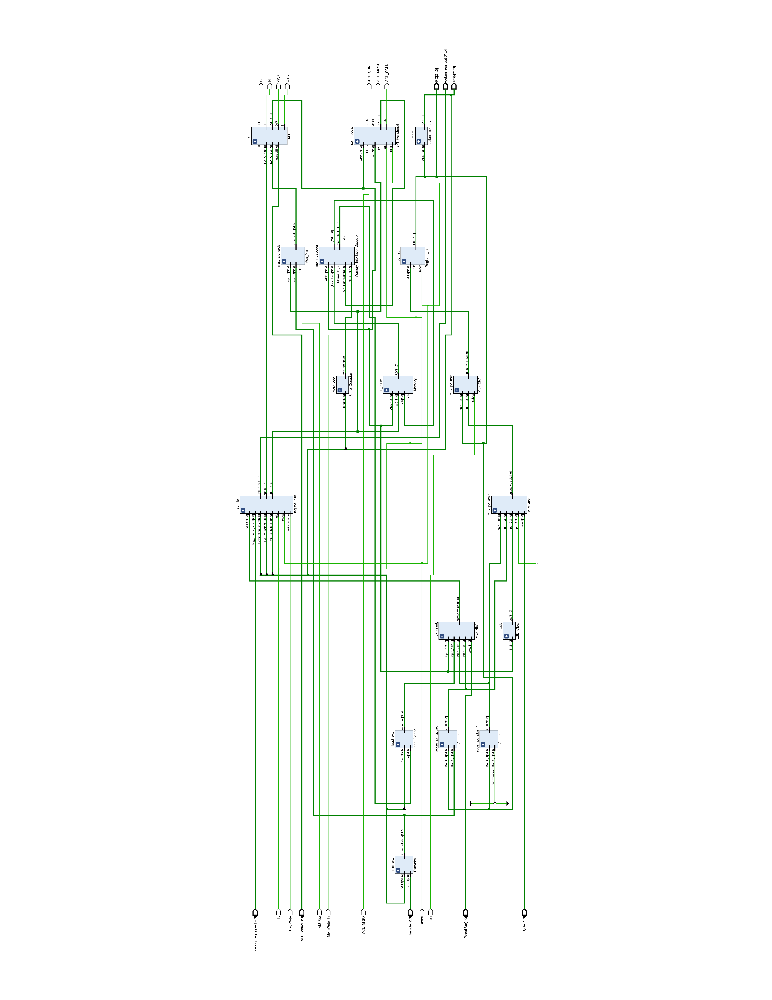

# rv32i-fpga-soc

A single-cycle **RISC-V RV32I** processor in Verilog for the **Digilent Nexys A7-100T** (Xilinx Artix-7), with a memory-mapped **SPI master** that talks to the board's on-board **ADXL362** accelerometer.

The core can be single-stepped from a push button while the program counter and any register are shown on the seven-segment display, so you can watch a program run one instruction at a time. A cocotb testbench checks the core against a Python reference model.

## Features

- RV32I base integer instruction set, single-cycle datapath
- Byte, halfword and word loads and stores (`LB/LH/LW/LBU/LHU`, `SB/SH/SW`) with sign/zero extension
- Branches (`BEQ BNE BLT BGE BLTU BGEU`), `JAL`, `JALR`, `LUI`, `AUIPC`
- 1 KB byte-addressable data memory, 1 KB instruction memory (256 words)
- Memory-mapped SPI master for the ADXL362 (mode 0, 1 MHz SCLK)
- 50 MHz system clock derived from the board's 100 MHz oscillator by an MMCM (the single-cycle critical path is about 17 ns, so it does not fit in 10 ns)
- Board front end: debounced buttons, single-step control, register/PC display on the 7-segment digits
- Self-checking simulation: every retired instruction is compared with a Python model of RV32I

Not implemented: `FENCE`, `ECALL`/`EBREAK`, the CSR instructions and misaligned memory accesses. The control unit treats unknown opcodes as no-ops.

## Repository layout

| Path | Contents |
|------|----------|
| `rtl/` | Verilog sources |
| `constraints/` | Nexys A7-100T pin constraints (`.xdc`) |
| `sim/` | cocotb testbench, Makefile, test program (`Instructions.hex` / `Instructions.txt`) |
| `docs/` | Block diagrams (controller, datapath, SPI) as PNG and PDF |
| `create_project.tcl` | Recreates the Vivado project |

## Architecture

`RISCV_Top` (`rtl/riscv_top.v`) joins a `Control_Unit` (`controller.v`) and a `RISCV_Datapath` (`datapath.v`). `Nexys_A7` (`project_top_module.v`) is the board-level top module that adds the button debouncing, step pulse and display driver around it.

```
Nexys_A7                     board top: clock, buttons, 7-segment display, LEDs
├─ MMCME2_BASE + BUFG        100 MHz in, 50 MHz system clock out
├─ debouncer                 filters the five push buttons
├─ OnePulse                  turns the BTNU press into a one-cycle step enable
├─ MSSD (+ SSD)              multiplexed 8-digit seven-segment driver
└─ RISCV_Top
   ├─ Control_Unit           opcode / funct decode, branch and PC-source logic
   └─ RISCV_Datapath         PC, register file, ALU, memories, SPI, extenders
```

Diagrams (generated from the RTL):

- Datapath: [`docs/datapath.png`](docs/datapath.png) ([PDF](docs/datapath.pdf))
- Control unit: [`docs/controller.png`](docs/controller.png) ([PDF](docs/controller.pdf))
- SPI peripheral: [`docs/spi.pdf`](docs/spi.pdf)



### Control

The control unit decodes the opcode into `RegWrite`, `ALUSrc`, `MemWrite`, `ResultSrc`, `ImmSrc` and a 2-bit `PCSrc` (`00` PC+4, `01` branch/JAL target, `10` JALR target). The ALU control code comes from the opcode and `funct3`/`funct7[5]`. Branch decisions use the ALU flags (Zero, N, overflow, carry), so signed compares use `N != OVF` and unsigned compares use the carry.

### ALU

Operations: add, subtract, AND, OR, XOR, shift left/right logical, shift right arithmetic, signed and unsigned set-less-than, and a pass-B path used for `LUI`.

## Memory map

| Address | What |
|---------|------|
| `0x000`-`0x3FF` | Data memory (1 KB, byte addressable) |
| `0x400` | SPI `TX_Data` (word, little endian) |
| `0x404` | SPI `TX_Length` (byte, number of bytes to send, at most 4) |
| `0x405` | SPI `RX_Length` (byte, number of bytes to receive, at most 4) |
| `0x406` | SPI `X_Start` (byte, write to start a transaction) |
| `0x408` | SPI `RX_Data` (word, little endian) |

The SPI window is `0x400`–`0x40F`; the memory interface decoder routes accesses in that range to the SPI peripheral instead of the data memory. Instruction memory is a separate array addressed by the PC.

The data memory is four byte-wide banks with an asynchronous read, which Vivado maps to distributed (LUT) RAM. Its size is the `DEPTH` parameter in `rtl/Memory.v` (default 1 KB, ending where the SPI window begins). Accesses must be naturally aligned: halfwords on even addresses and words on multiples of four. Misaligned accesses that cross a word boundary are not supported (writes drop the extra bytes, reads return zero).

## SPI peripheral

`SPI_Peripheral.v` is an SPI master for the ADXL362 (CPOL=0, CPHA=0). SCLK is 1 MHz, divided down from the system clock (the `CLK_HZ` parameter, 50 MHz on the board). A transaction asserts chip select, shifts out `TX_Length` bytes (byte 0 first, MSB first within each byte), then shifts in `RX_Length` bytes into `RX_Data`, then releases chip select. Software writes the length registers and `TX_Data`, then writes `X_Start`, waits for the transfer to complete, and reads `RX_Data`. There is no done or busy flag: `X_Start` clears as soon as the transaction begins, so software has to wait long enough itself (a transfer takes 1 µs per bit). See [`docs/spi.pdf`](docs/spi.pdf) for the schematic.

## Using the board

| Control | Function |
|---------|----------|
| `BTNU` | Execute one instruction (single step) |
| `BTND` | Reset |
| `SW[4:0]` | Select which register (x0-x31) to show |
| `SW[15:0]` | Mirrored on `LED[15:0]` |
| 7-segment display | Left two digits: PC (low byte). Right six digits: low 24 bits of the selected register |

The debouncer, display driver, processor and SPI peripheral all run on the 50 MHz system clock (an MMCM divides the board's 100 MHz clock; the core is held in reset until it locks). A button press only enables one instruction to commit, so an SPI transfer started by a store still completes at full speed.

## Simulation

The testbench ([`sim/riscv_test.py`](sim/riscv_test.py)) uses [cocotb](https://www.cocotb.org/) with [Icarus Verilog](https://steveicarus.github.io/iverilog/). It loads `sim/Instructions.hex` into the instruction memory, runs the same program through a Python RV32I reference model, and after every instruction compares the PC and all 32 registers, printing a table that is green when they match and red when they differ.

```
pip install cocotb
cd sim
make
```

Run `make` from inside `sim/`, because the memory loads `Instructions.hex` by relative path. The included program (`Instructions.txt` is the annotated listing) exercises arithmetic, logic, shifts, comparisons, loads/stores of every width, all six branch types, `JAL` and `JALR`. The test program does not use the SPI peripheral, so that block has no automated test yet.

On Windows, `make` needs a Unix-style shell such as MSYS2, with Python and Icarus Verilog on its `PATH`.

## Building for the FPGA

Requires Vivado. From the repository root:

```
vivado -mode batch -source create_project.tcl
```

or run `source create_project.tcl` from the Vivado Tcl console. This creates `vivado_project/` for the `xc7a100tcsg324-1` part with `Nexys_A7` as the top module. Open the project, run synthesis and implementation, and program the board.

To run your own program, replace `sim/Instructions.hex` (one 32-bit hex word per line) and rebuild: the instruction memory is initialised from that file at synthesis time.

## References

- [RISC-V Instruction Set Manual, Volume I: Unprivileged ISA](https://riscv.github.io/riscv-isa-manual/snapshot/unprivileged/)
- [Analog Devices ADXL362 datasheet](https://www.analog.com/en/products/adxl362.html)
- [Digilent Nexys A7 reference manual](https://digilent.com/reference/programmable-logic/nexys-a7/reference-manual)
- The constraints file is Digilent's public Nexys A7-100T master `.xdc`.

## License

The RTL, testbench, scripts and documentation are released under the MIT License; see [LICENSE](LICENSE).

`constraints/Nexys-A7-100T-Master.xdc` is derived from [Digilent's constraints repository](https://github.com/Digilent/digilent-xdc) and is also MIT licensed, copyright Digilent; see [constraints/LICENSE](constraints/LICENSE).
